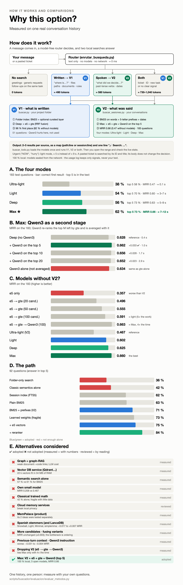

# brain-optimized-memory-for-claude-code

**🇲🇽 [ESPAÑOL](#español)** (primero, aquí abajo) · **🇬🇧 [ENGLISH](#english)** (below, same page)

---

# ESPAÑOL

## Memoria local para Claude Code

Búsqueda 100 % local en tus **conversaciones pasadas de Claude Code**, más un sistema de *directivas*, *memoria* y *skills* reutilizables que hace que Claude siga tus reglas con poco contexto. Nada sale de tu equipo mientras buscas; lo único que usa la red es instalar los modelos abiertos (tres, el último opcional), una sola vez.


## Qué incluye
- **`scripts/buscador/`**: búsqueda de conversaciones con **cuatro modos**: **Ultra ligero** (V2: BM25 sobre palabras y prefijos de 5 letras + fusión RRF + fechas en español, SQLite FTS5, solo biblioteca estándar de Python, sin modelos), **Ligero** (candidatos de V2 reordenados por `gte-multilingual-reranker-base`), **Profundo** (suma vectores de `multilingual-e5-small`) y **Máximo** (además, `Qwen3-Reranker-0.6B` reordena los 5 mejores; es el modo por defecto cuando está instalado). El modo base se elige con `--modo`; una bandera explícita (`--ligero` para lo urgente) manda sobre él. Los modos con modelos corren sin red, en un entorno aislado, con modelos de solo lectura y verificados por huella. **Al terminar la instalación el entorno queda sellado automáticamente: ni usando su Python directamente puede salir a internet** (compruébalo cuando quieras con `scripts/buscador/verificar_aislamiento.py`).
- **`scripts/buscador/buscar_todo.py` (V1 + V2)**: busca a la vez en los **archivos del proyecto** (V1, con modo Profundo) y en las **conversaciones** (V2); el enrutador `--auto` decide si buscar, dónde y cuántos resultados, y un registro local (solo señales) ayuda a afinar el criterio con tu uso real.
- **`scripts/directivas-buscador/`**: un hook que en cada mensaje inyecta solo las directivas y memorias más afines, para no cargar un archivo de reglas largo cada vez.
- **`.context/`, `plantillas/`**: directivas de ejemplo, palabras de disparo, `CLAUDE.md`, configuración de hooks y memorias (todo ficticio; reemplázalo por lo tuyo).
- **`skills/`**: tres skills reutilizables: `buscar-conversaciones`, `trazabilidad`, `actualizar-directivas`.
- **`docs/`**: manual de instalación, arquitectura, directivas y memoria, seguridad y privacidad, resultados y lecciones.

## Inicio rápido
> 💡 **Pídele a tu Claude que te ayude con la instalación.** Abre Claude Code en tu proyecto y pega este mensaje: «*Lee README.md y docs/instalacion.md de este repositorio y ayúdame a instalar la búsqueda local de conversaciones en mi proyecto. Antes de ejecutar nada, dime qué vas a hacer; pídeme confirmación antes de los pasos con red (preparar_profundo.py y preparar_maximo.py). No modifiques mi CLAUDE.md ni mi .claude/settings.json sin mostrarme el cambio, y no subas nada a internet. Al terminar corre verificar_aislamiento.py y tests/smoke_test.py.*». El **manual completo paso a paso** (requisitos, instalación, verificación, problemas frecuentes y desinstalar) está en [`docs/instalacion.md`](docs/instalacion.md).

Requiere Python ≥ 3.12. **macOS: probado** (la capa de sistema contra la red usa `sandbox-exec`) · **Linux: no probado** · **Windows: no compatible tal cual** (solo modo `--solo-v2`, o WSL2 sin probar). Detalle en [`docs/instalacion.md`](docs/instalacion.md).
```bash
# 1) opcional, una vez (con red): entorno aislado + modelos del Ligero y del Profundo; al terminar se sella solo contra internet
python3 -I scripts/buscador/preparar_profundo.py
# 1b) opcional (con red): agrega el nivel Máximo (Qwen3-Reranker, ≈ 1.2 GB); vuelve a sellar al terminar
python3 -I scripts/buscador/preparar_maximo.py

# 2) buscar en las sesiones del proyecto actual (modo base: Máximo si está instalado; si no, Profundo)
python3 -I scripts/buscador/buscar_sesiones.py "¿qué decidimos del formato del reporte semanal?" --excluir <uuid de la sesión actual>
python3 -I scripts/buscador/buscar_sesiones.py "algo urgente" --ligero          # solo esta búsqueda, en modo ligero
python3 -I scripts/buscador/buscar_sesiones.py "término exacto" --ultraligero   # sin modelos (igual: --solo-v2)

# 3) elegir el modo base (ultraligero | ligero | profundo | maximo); sin valor, muestra el actual
python3 -I scripts/buscador/buscar_sesiones.py --modo ligero
```
Sin los modelos instalados, el buscador avisa y usa V2 (Ultra ligero).
Para usar las directivas y el hook en tu proyecto: copia `scripts/`, `.context/` y `plantillas/CLAUDE.md` (como `CLAUDE.md`), mezcla `plantillas/settings.json` en `.claude/settings.json`, copia `skills/*` a `.claude/skills/` y escribe tus directivas con el formato descrito al inicio de `.context/directivas.md`. Luego corre `python3 -I scripts/directivas-buscador/directivas_buscador.py mapa`.

Variables de entorno: `BUSCADOR_HOME` (dónde viven índice y modelos, por defecto `~/.memoria-local`), `CLAUDE_PROJECT_DIR`, `BUSCADOR_ZONA` (zona horaria), `BUSCADOR_SIGLAS` (siglas de 2 letras que cuentan como palabra).

## Cómo funciona
Hay **dos búsquedas locales** y un **enrutador** (solo texto, sin modelos, sin red) que decide cuál usar para cada mensaje:
```
 Tu mensaje o ticket ──► Enrutador (enrutar_busqueda.py, ≈ 0 ms)
                              │
      ┌───────────────┬───────┴────────┬──────────────────────┐
      ▼               ▼                ▼                      ▼
  No busca      📁 V1: lo escrito   💬 V2: lo hablado      Las dos
  saludos,      buscar.py           buscar_sesiones.py     ticket, ID,
  genéricos,    (carpeta)           (conversaciones)       tarea nueva
  seguimientos        └────────┬───────┘                    │
                               ▼  buscar_todo.py carga los modelos una vez
                 2–3 resultados por fuente (ruta:línea o sesión:línea)
                 + una línea «🔎 Búsqueda: …» → se abre el rango y se verifica el estado vivo
```
| | 📁 **V1: lo escrito** (`buscar.py`) | 💬 **V2: lo hablado** (`buscar_sesiones.py`) |
|---|---|---|
| **Qué busca** | Documentos, notas, scripts, trazabilidad, directivas de tu carpeta | Tus conversaciones pasadas con Claude Code |
| **Base** | BM25 (SQLite FTS5) + capa curada opcional + prioridades por tipo de archivo | BM25 sobre palabras + prefijos de 5 letras + fechas en español |
| **Por defecto** | **Profundo:** base + e5 + gte → 96 % de primer lugar (82 % sin modelos) | **Máximo:** V2 + e5 + gte + Qwen3 en los 5 mejores → MRR 0.66 (0.47 sin modelos) |
| **Más ligeros** | Ligero (+ gte, igual de preciso) · rápido (solo BM25) | Profundo · Ligero · Ultra ligero |
| **Qwen3** | ❌ empeora, no se usa | ✅ aporta (+0.033 de MRR) |

| Señal en el mensaje | Qué se busca | Costo medido |
|---|---|---|
| Saludo, pedido genérico («explica…»), seguimiento corto | **Nada** | 0 tokens |
| «¿Dónde está…?», «¿en qué archivo…?», una ruta o directiva | 📁 **V1** (solo rutas si basta ubicar el archivo) | ≈ 490 (≈ 330) tokens |
| «¿Qué decidimos…?», verbos de pasado, fechas | 💬 **V2** | ≈ 580 tokens |
| Ticket, ID, URL, tarea nueva, o sin señal clara; antes de decir «no hay» | 📁💬 **Las dos** (2 resultados si el término es exacto) | ≈ 730–1,040 tokens |
| «YA», «apúrate», «urgente» | Lo que toque, en **modo ligero** (≈ 5 s en vez de ≈ 9 s) | no ahorra tokens, solo tiempo |
Un **ticket pegado** se busca por su ID y título; su cuerpo no cambia la decisión. Reglas completas: [`docs/criterio-busqueda.md`](docs/criterio-busqueda.md).

## Buscar en todo: carpeta (V1) y conversaciones (V2)
Además de las conversaciones, puedes buscar **en los archivos de tu proyecto** (notas, documentos, scripts, trazabilidad). **V1** es un índice SQLite FTS5 (BM25) de la carpeta; su **modo Profundo** mezcla (RRF) ese ranking con `multilingual-e5-small` y `gte-multilingual-reranker-base`, **los mismos modelos que ya instalas** (sin descargas nuevas). Un solo comando busca en las dos fuentes y comparte los modelos:
```bash
python3 -I scripts/buscador/buscar_todo.py "<mensaje>" --auto --excluir <uuid de la sesión actual>   # decide solo si buscar, dónde y cuántos resultados
python3 -I scripts/buscador/buscar_todo.py "<mensaje>" --explica                                   # solo muestra la decisión, sin buscar
python3 -I scripts/buscador/buscar_todo.py --marca v1|v2|ambas|ninguna <tarea>                      # al cerrar una tarea: qué fuente aportó (registro local)
python3 -I scripts/buscador/buscar_todo.py --informe                                               # resumen local de uso para afinar el criterio
```
- **Enrutador (`--auto`)**: decide con señales del mensaje, sin modelos y sin red: saludos, pedidos genéricos y seguimientos cortos **no buscan**; «¿qué decidimos…?», verbos de pasado y fechas van a **conversaciones**; «¿dónde está…?» y «¿en qué archivo…?» van a la **carpeta**; un ticket, una URL o una tarea sin señal clara van a **las dos**; «YA», «apúrate» o «urgente» activan el modo rápido. Un **ticket pegado** completo se busca por su ID y título, y su cuerpo no cambia la decisión. Todas las reglas, el orden y los costos: [`docs/criterio-busqueda.md`](docs/criterio-busqueda.md).
- **Medido por el autor** (su carpeta y su historial; son orientación, mide con lo tuyo): carpeta, primer lugar **82 % → 96 %** y MRR **0.898 → 0.973** en 51 preguntas (BM25 solo → Profundo); enrutador **96–100 %** por grupo en 288 mensajes (92 con los que se afinó, 91 de control); costo medio **≈ 770 tokens por mensaje frente a ≈ 1,040** si siempre se buscara en las dos (−26 %: casi todo el ahorro viene de no buscar en saludos, pedidos genéricos y seguimientos; en tareas es de ≈ 5–10 %).
- **Enrutador mejorado (2026-11-27):** además de elegir fuente, **no busca** cuando no hace falta (cómo-hacer general, comandos pegados, enlaces o imágenes sin contexto, Slack/Jira por leer, «¿qué sigue?») y trata mejor los **adjuntos por ruta** (se leen y se buscan por nombre y tema), «dime cómo quedó…» (las dos fuentes) y tus **temas propios** (`.context/enrutador-temas.tsv`, opcional; ejemplo en `plantillas/enrutador-temas.ejemplo.tsv`). Con mensajes reales del autor en cuatro tandas ciegas: 27 % → 68 % de acierto en la última y 956 → 610 tokens por mensaje (cifras del autor; mide con las tuyas). Detalle en `docs/criterio-busqueda.md` § 5 ter.
- **Tiempos:** la primera vez vectoriza la carpeta (≈ 2–3 min por cada 28,000 trozos, ≈ 60 MB, una sola vez; después solo lo nuevo o cambiado); luego ≈ 8–10 s por búsqueda (≈ 5 s en modo urgente).
- **Registro local en segundo plano:** cada búsqueda con `--auto` guarda en `~/.memoria-local/uso/` solo señales (decisión, fuente, tamaño, identificadores de lo mostrado), **nunca el texto de tus mensajes ni de tus conversaciones**; con `--marca` anotas qué fuente sirvió y cada 25 mensajes se genera solo un informe (`informe_criterios.md`) para ajustar las reglas con tu uso real. `--borrar-uso-enrutador` lo elimina.
- **¿Qué carpetas necesito?** Ninguna nueva: V1 funciona sobre cualquier carpeta. Opcional: `docs/` con una línea `> **Resumen:** …` bajo el título, y un `.context/indice.md` (plantilla en `plantillas/indice.ejemplo.md`) mejoran el orden. Detalle en [`docs/instalacion.md`](docs/instalacion.md) › «Carpetas».

## Elegir el modo
El **modo base** lo usa toda búsqueda sin bandera. Se cambia con `--modo` (por ejemplo, `--modo ligero`; sin valor muestra el actual). Una bandera explícita manda sobre el modo base: `--ligero` en una búsqueda urgente sale ligera aunque el base sea Máximo.

## Por qué esta opción (comparativas)


> **Una persona, un historial:** las cifras son orientación, no garantía. Mide con tus propias preguntas (`scripts/buscador/evaluacion/evaluar_metodos.py`). Todo el detalle está en [`docs/resultados.md`](docs/resultados.md). **MRR** = qué tan arriba queda la respuesta correcta (1 = siempre primera).

### 1. Los cuatro modos (183 preguntas de prueba, parte escritas por Claude)
| Modo | Respuesta en el top 5 | Primer resultado | MRR | Comando completo |
|:--|:--|:-:|:-:|:-:|
| **Ultra ligero** (V2, sin modelos) | `████████████░░░░░░░░` 58 % | 38 % | 0.47 | ≈ 0.1 s |
| **Ligero** (V2 + reordenador) | `██████████████░░░░░░` 70 % | 54 % | 0.60 | ≈ 3–7 s |
| **Profundo** (V2 + vectores + reordenador) | `███████████████░░░░░` 73 % | 56 % | 0.63 | ≈ 5–9 s |
| **Máximo** (profundo + Qwen3 en los 5 mejores) | `███████████████░░░░░` 73 % | **62 %** | **0.66** | ≈ 7–12 s |

El Máximo no sube el top 5 (Qwen3 solo reordena lo que ya estaba arriba): sube el **primer lugar** de 56 % a 62 %, +0.033 de MRR sobre el profundo (IC95 [+0.014, +0.055]) y positivo en las tres tandas. Los tiempos van de una Mac libre a una con carga; con los modelos ya cargados una consulta cuesta ≈ 0.4 s (profundo) y ≈ 1.0 s (Máximo).

**Cómo se llegó al Máximo** (Qwen3 como segunda etapa sobre los mejores M que dejó `gte`):
| Segunda etapa | MRR | 1.º | Contra el profundo | Por consulta |
|:--|:-:|:-:|:--|:-:|
| **Qwen3 en los 5 mejores** (promedio z con gte) | **0.662** | 62 % | **+0.033 [+0.014, +0.055]** ✅ | 1.0 s |
| Qwen3 en los 10 mejores | 0.656 | 61 % | +0.028 [+0.003, +0.054] | 1.7 s |
| Qwen3 en los 20 mejores | 0.652 | 60 % | +0.023 [−0.003, +0.050] | 2.9 s |
| Qwen3 solo, sin promediar con gte | 0.632–0.636 | 57 % | ≈ 0 ❌ | |
La mejora viene de **promediar** dos reordenadores que se equivocan en preguntas distintas; Qwen3 solo rinde igual que gte solo y cuesta 6 veces más.

### 2. ¿Y si usamos solo los modelos, sin V2? (MRR en las mismas 183)
| Opción | MRR | Lectura |
|:--|:-:|:--|
| e5 solo (vectores) | 0.357 | ❌ peor que V2 solo |
| e5 → reordenador gte, 20 candidatos | 0.496 | queda cerca de V2 solo |
| e5 → reordenador gte, 50 candidatos | 0.555 | |
| e5 → reordenador gte, 100 candidatos | 0.591 | ≈ ligero (diferencia no significativa), con 5 veces más trabajo del reordenador |
| V2 solo | 0.467 | referencia |
| **Ligero** | **0.602** | ✅ |
| **Profundo** | **0.625** | ✅ la respuesta está entre los 100 primeros candidatos en 163 de 183 con V2 y en 153 con vectores: **se complementan** |
| **Máximo** | **0.66** | ✅ el mejor medido (sección 1) |
| e5 → gte (100 candidatos) → Qwen3 en los 20 mejores, **sin V2** | 0.663 | iguala al Máximo, pero con 4 veces el tiempo (≈ 4.5 s contra ≈ 1 s por consulta) y 100 pares para gte en vez de 20 ❌ |

### 3. Cómo llegamos aquí (92 preguntas; respuesta en el top 5 · primer resultado)
| Paso | Top 5 | 1.º | Qué aprendimos |
|:--|:--|:-:|:--|
| Búsqueda solo en la carpeta de trabajo (documentos + hook) | `███████░░░░░░░░░░░░░` 36 % | 18 % | no ve las conversaciones: 0 % en lo que solo vive en ellas |
| Semántica clásica sola (PPMI + SVD con el propio texto) | `████████░░░░░░░░░░░░` 42 % | 23 % | mala sola; mezclada con BM25 empeora (61 %) |
| Índice de sesiones con FTS5 | `████████████░░░░░░░░` 62 % | 41 % | el primer salto: los hechos que solo viven en conversaciones pasan de 19 % a 54 % |
| BM25 plano | `█████████████░░░░░░░` 63 % | 48 % | |
| **BM25 + prefijos de 5 letras (RRF) = V2** | `██████████████░░░░░░` 71 % | 50 % | la ganancia sin modelos viene de fusionar un índice de prefijos (variantes de palabra); más letras no sube la precisión |
| Pesos aprendidos con 14 señales | `███████████████░░░░░` 73 % | 52 % | frágil con pocos datos: el 77 % de una partición fue suerte |
| + vectores e5-small | `███████████████░░░░░` 75 % | 47 % | complemento: solo semántico (57 %) es peor que BM25 (61 %) |
| **+ reordenador gte (leer pregunta y turno juntos)** | `█████████████████░░░` 84 % | 70 % | el salto grande |

### 4. Otras opciones que consideramos
| Opción | Qué vimos | Decisión |
|:--|:--|:--|
| **Búsqueda solo en la carpeta / archivos de instrucciones** (CLAUDE.md, skills) | Complementan, pero no ven lo hablado: 19 % en hechos que solo viven en conversaciones (48 preguntas independientes) contra 54 % con un índice de sesiones | ✅ siguen como primera línea para lo documentado |
| **Grafo de conocimiento** (graphify) y **RAG con grafos** | Probado sin LLM sobre ≈ 2,500 nodos: útil como mapa visual por tema, pero solo 124 de ≈ 3,200 aristas eran enlaces reales entre documentos y los enlaces documento→código eran débiles; para documentos exige un LLM (costo y privacidad). Sin evidencia de que supere a BM25 + vectores | ❌ para recuperar conversaciones |
| **Base de datos de vectores como servicio** (Qdrant y similares) | Los vectores de ≈ 22 mil turnos ocupan ≈ 34 MB: caben en memoria con numpy | ❌ innecesaria |
| **Solo búsqueda semántica** (e5-small, bge-m3) | 57 % y 56 % en el top 5 contra 61 % de BM25 (77 preguntas); mezclada sube a 74–77 %; bge-m3 tardó 1,027 s contra 85 s, usó 4 veces más disco y no ganó | ✅ vectores solo como complemento (e5-small) |
| **Modelo propio pequeño** (destilación de dos reordenadores) | MRR 0.208 solo y 0.351 reordenando los 20 de V2 (V2: 0.467) | ❌ no supera a V2 (0.208 contra 0.467) |
| **Matemática clásica entrenada con el propio texto** | 42 % sola; los pesos aprendidos llegan a 73 % pero son frágiles | ❌ queda V2 con prefijos |
| **Afinar BM25** (27 variantes, 64 configuraciones) | Ninguna mejoró de forma significativa: el orden léxico está en su techo | ❌ sin mejora: el orden léxico ya está en su techo |
| **MemPalace** | Se probaron sus dos ideas por separado: guardado automático al compactar (sin mejora: el resumen conserva 77–85 %) e índice aparte de sesiones pasadas (funciona; es la base de esta herramienta) | ✅ la idea del índice · ❌ el producto (superficie amplia de herramientas) |
| **Servicios de memoria que envían el texto fuera** (p. ej. mem4dev, según su documentación) | Suben el texto de las conversaciones a servicios externos | ❌ incompatible con privacidad local |
| **Plugins que graban y resumen con un LLM** (claude-mem, según su README) | Podrían capturar salidas con credenciales y mandarlas a un LLM; gastan tokens extra | ❌ riesgo para la privacidad y gasto extra de tokens |
| **qmd** (BM25 + vectores + reordenador locales para notas Markdown) | El más parecido en espíritu, pero para notas en Markdown, no para las sesiones de Claude Code; modelos de ≈ 2 GB orientados al inglés | ⏸ no probado |
| **Engram** | No se evaluó | ⏸ pendiente |
| **Stemmers y lematizadores en español** (Snowball, Light de Savoy, Minimal de Lucene, simplemma) como lista extra junto a palabras y prefijos | Ninguno mejoró de forma significativa (ΔMRR entre −0.017 y +0.007); reemplazar los prefijos empeora (Snowball solo: 0.417 contra 0.469) | ❌ quedan los prefijos de 5 letras |
| **LanceDB** (base embebida con búsqueda híbrida) | Su stemmer en español es el mismo Snowball (y su idioma por defecto es inglés); a esta escala no aporta frente a SQLite + numpy y añade pyarrow y ruedas nativas | ❌ |
| **Cascadas Snowball ↔ prefijos** (uno encuentra, el otro ordena) | −0.003 a −0.051 de MRR: lo que la primera etapa no encuentra no lo recupera la segunda | ❌ |
| **Más candidatos para el reordenador** (30 a 60), con o sin vectores | MRR sin cambio (+0.000 a +0.003): la cobertura sube, pero el cuello de botella es el orden | ❌ |
| **Fusionar variantes del Máximo en paralelo** (RRF) | Dos corridas iguales dan lo mismo; variantes distintas rinden igual (0.653–0.655 contra 0.658) porque se equivocan en las mismas preguntas | ❌ |
| **Mezclar el orden del reordenador con el de BM25** (RRF) | −0.014 a −0.052 de MRR: diluye al reordenador | ❌ |
| **Contexto del turno anterior** (versión barata de «contextual retrieval», sin LLM) | Empeora: −0.012 (solo turnos cortos) y −0.031 (todos); la versión con LLM no se probó | ❌ |
| **Instrucción de tarea para Qwen3-Reranker** (español o inglés en lugar de la de fábrica) | −0.004 a −0.006 de MRR | ❌ |
| **JEV** (modelo de decisión por API) | Solo por API (el texto saldría del equipo) y devuelve respuestas tipadas con probabilidades, no ordena documentos; no se probó | ❌ |
Las evaluaciones de herramientas de terceros son de octubre y noviembre de 2026 (documentación, README y código leídos; solo graphify se ejecutó, sin LLM y sin llaves de API); pueden haber cambiado.

### 5. Por qué esta opción
1. **Resuelve el hueco real:** los hechos que solo viven en conversaciones pasadas. En 35 preguntas sin documentar: carpeta 0 %, FTS5 49 %, V2 63 %, con modelos 80 %.
2. **100 % local:** sin servicio, sin llaves de API y sin telemetría; modelos abiertos sellados al instalar y la red bloqueada en tres capas.
3. **Escalonada:** pagas tiempo solo cuando hace falta (0.1 s → 3–7 s → 5–9 s → 7–12 s); eliges el modo base y una bandera lo cambia en una búsqueda urgente.
4. **Fácil de replicar:** V2 usa solo la biblioteca estándar de Python y SQLite; los modelos son opcionales.
5. **Honesta con sus límites:** las preguntas de «dos pasos» casi siempre fallan; puede devolver decisiones ya superadas (mira la fecha); es un solo historial.

## Privacidad
El índice guarda **todo lo que escribiste, sin enmascarar** (contraseñas incluidas si las pegaste). Mantén `~/.memoria-local` privado y no lo publiques. Los modelos son abiertos (MIT y Apache-2.0), con commit fijado, huella verificada y de solo lectura; las búsquedas corren con la red bloqueada en tres capas (archivos, código, sistema). Los límites se describen con honestidad en `docs/seguridad-y-privacidad.md`.

## Pruebas
`python3 -I tests/smoke_test.py` arma un proyecto y sesiones sintéticas en una carpeta temporal y comprueba el analizador de fechas, la búsqueda (V1 y V2), el enrutador, el mapa de directivas y el hook. `python3 -I tests/test_enrutador.py` prueba solo el enrutador, y `python3 -I tests/test_buscar_todo.py` hace la prueba de punta a punta con modelos (se omite si no están instalados). `python3 -I tests/test_modo.py` comprueba la elección del modo base (archivo, `--modo` y banderas). Nunca tocan tu índice real.

## Licencia
MIT. Los modelos de terceros conservan sus licencias (MIT, Apache-2.0).

---

# ENGLISH

## Local memory for Claude Code

100 % local search over your **past Claude Code conversations**, plus a small system of reusable *directives*, *memory* and *skills* that keeps Claude following your rules with little context. Nothing leaves your machine while you search; the only step that uses the network is installing the open models (three, the last one optional) once.


## What is inside
- **`scripts/buscador/`** – conversation search with **four modes**: **Ultra-light** (V2: BM25 over words and 5-letter prefixes + RRF fusion + Spanish date filters, SQLite FTS5, Python standard library only, no models), **Light** (V2 candidates re-ranked by `gte-multilingual-reranker-base`), **Deep** (also adds `multilingual-e5-small` vectors) and **Max** (additionally `Qwen3-Reranker-0.6B` re-ranks the top 5; it is the default when installed). The base mode is chosen with `--modo`; an explicit flag (`--ligero` for urgent things) wins over it. The model modes run offline in an isolated environment, with read-only, hash-verified models. **When the install finishes, the environment is sealed automatically: even running its Python directly cannot reach the internet** (verify any time with `scripts/buscador/verificar_aislamiento.py`).
- **`scripts/buscador/buscar_todo.py` (V1 + V2)** – searches **project files** (V1, with a Deep mode) and **conversations** (V2) at once; the `--auto` router decides whether to search, where and how many results, and a local log (signals only) helps tune the criterion with your real usage.
- **`scripts/directivas-buscador/`** – a hook that, on every message, injects only the directives and memories most relevant to it, so a long rules file does not have to be loaded every time.
- **`.context/`, `plantillas/`** – example directives, trigger words, `CLAUDE.md`, hook settings and memory files (all fictional examples; replace them with yours).
- **`skills/`** – three reusable skills: `buscar-conversaciones`, `trazabilidad`, `actualizar-directivas`.
- **`docs/`** – installation manual (Spanish and English), architecture, directives and memory, security and privacy, results and lessons (Spanish).

## Quick start
> 💡 **Ask your Claude to help you install it.** Open Claude Code in your project and paste this message: "*Read README.md and docs/instalacion.md in this repository and help me install the local conversation search in my project. Before running anything, tell me what you are going to do; ask me for confirmation before the steps that use the network (preparar_profundo.py and preparar_maximo.py). Do not modify my CLAUDE.md or my .claude/settings.json without showing me the change, and do not upload anything to the internet. When finished, run verificar_aislamiento.py and tests/smoke_test.py.*". The **full step-by-step manual** (requirements, install, verification, common problems and uninstall) is in [`docs/instalacion.md`](docs/instalacion.md) (Spanish first, English below).

Requires Python ≥ 3.12. **macOS: tested** (the system network layer uses `sandbox-exec`) · **Linux: untested** · **Windows: not supported as is** (`--solo-v2` mode only, or WSL2, untested). Details in [`docs/instalacion.md`](docs/instalacion.md).
```bash
# 1) optional, once (needs network): isolated environment + the Light and Deep models; it seals itself from the internet when it finishes
python3 -I scripts/buscador/preparar_profundo.py
# 1b) optional (needs network): add the Max level (Qwen3-Reranker, ≈ 1.2 GB); it seals again when it finishes
python3 -I scripts/buscador/preparar_maximo.py

# 2) search the sessions of the current project (base mode: Max if installed; otherwise Deep)
python3 -I scripts/buscador/buscar_sesiones.py "what did we decide about the weekly report format?" --excluir <current-session-uuid>
python3 -I scripts/buscador/buscar_sesiones.py "something urgent" --ligero        # this search only, in light mode
python3 -I scripts/buscador/buscar_sesiones.py "exact term" --ultraligero         # no models (same as --solo-v2)

# 3) pick the base mode (ultraligero | ligero | profundo | maximo); with no value it shows the current one
python3 -I scripts/buscador/buscar_sesiones.py --modo ligero
```
Without the models installed, the search warns and uses V2 (Ultra-light).
To use the directives and hook in your own project: copy `scripts/`, `.context/` and `plantillas/CLAUDE.md` (as `CLAUDE.md`) into it, merge `plantillas/settings.json` into `.claude/settings.json`, copy `skills/*` to `.claude/skills/`, and write your own directives following the format described at the top of `.context/directivas.md`. Then run `python3 -I scripts/directivas-buscador/directivas_buscador.py mapa`.

Environment variables: `BUSCADOR_HOME` (index/models location, default `~/.memoria-local`), `CLAUDE_PROJECT_DIR`, `BUSCADOR_ZONA` (time zone), `BUSCADOR_SIGLAS` (two-letter acronyms that count as words).

## How it works
There are **two local searches** and a **router** (text only, no models, no network) that decides which one to use for each message:
```
 Your message or ticket ──► Router (enrutar_busqueda.py, ≈ 0 ms)
                              │
      ┌───────────────┬───────┴────────┬──────────────────────┐
      ▼               ▼                ▼                      ▼
  No search     📁 V1: written      💬 V2: spoken          Both
  greetings,    buscar.py           buscar_sesiones.py     ticket, ID,
  generic,      (folder)            (conversations)        new task
  follow-ups          └────────┬───────┘                    │
                               ▼  buscar_todo.py loads the models once
                 2–3 results per source (path:line or session:line)
                 + one line "🔎 Search: …" → open the range and check the live state
```
| | 📁 **V1: what is written** (`buscar.py`) | 💬 **V2: what was said** (`buscar_sesiones.py`) |
|---|---|---|
| **What it searches** | Documents, notes, scripts, traceability, rules in your folder | Your past conversations with Claude Code |
| **Base** | BM25 (SQLite FTS5) + optional curated layer + priorities by file type | BM25 on words + 5-letter prefixes + Spanish dates |
| **Default** | **Deep:** base + e5 + gte → 96 % first place (82 % without models) | **Max:** V2 + e5 + gte + Qwen3 on the top 5 → MRR 0.66 (0.47 without models) |
| **Lighter ones** | Light (+ gte, equally precise) · fast (BM25 only) | Deep · Light · Ultra-light |
| **Qwen3** | ❌ hurts, not used | ✅ helps (+0.033 MRR) |

| Signal in the message | What is searched | Measured cost |
|---|---|---|
| Greeting, generic request ("explain…"), short follow-up | **Nothing** | 0 tokens |
| "Where is…?", "which file…?", a path or rule | 📁 **V1** (paths only if locating the file is enough) | ≈ 490 (≈ 330) tokens |
| "What did we decide…?", past-tense verbs, dates | 💬 **V2** | ≈ 580 tokens |
| Ticket, ID, URL, new task, or no clear signal; before saying "there is none" | 📁💬 **Both** (2 results if the term is exact) | ≈ 730–1,040 tokens |
| "NOW", "hurry", "urgent" | Whatever applies, in **light mode** (≈ 5 s instead of ≈ 9 s) | saves time, not tokens |
A **pasted ticket** is searched by its ID and title; its body does not change the decision. Full rules: [`docs/criterio-busqueda.md`](docs/criterio-busqueda.md).

## Search everything: folder (V1) and conversations (V2)
Besides conversations, you can search **your project files** (notes, documents, scripts, traceability). **V1** is a SQLite FTS5 (BM25) index of the folder; its **Deep mode** fuses (RRF) that ranking with `multilingual-e5-small` and `gte-multilingual-reranker-base`, **the same models you already install** (no new downloads). One command searches both sources and shares the models:
```bash
python3 -I scripts/buscador/buscar_todo.py "<message>" --auto --excluir <uuid of the current session>   # decides whether to search, where and how many results
python3 -I scripts/buscador/buscar_todo.py "<message>" --explica                                       # shows the decision only, no search
python3 -I scripts/buscador/buscar_todo.py --marca v1|v2|ambas|ninguna <task>                          # when closing a task: which source helped (local log)
python3 -I scripts/buscador/buscar_todo.py --informe                                                   # local usage summary to tune the criterion
```
- **Router (`--auto`)**: decides from signals in the message, with no models and no network: greetings, generic requests and short follow-ups **do not search**; "what did we decide…?", past-tense verbs and dates go to **conversations**; "where is…?" and "which file…?" go to the **folder**; a ticket, a URL or a task with no clear signal go to **both**; "NOW", "hurry" or "urgent" turn on fast mode. A **pasted ticket** is searched by its ID and title, and its body does not change the decision. All rules, order and costs: [`docs/criterio-busqueda.md`](docs/criterio-busqueda.md).
- **Measured by the author** (their folder and history; guidance only, measure with your own): folder, first place **82 % → 96 %** and MRR **0.898 → 0.973** on 51 questions (BM25 alone → Deep); router **96–100 %** per group on 288 messages (92 used for tuning, 91 held out); average cost **≈ 770 tokens per message versus ≈ 1,040** if both sources were always searched (−26 %: nearly all the saving comes from not searching on greetings, generic requests and follow-ups; on tasks it is ≈ 5–10 %).
- **Improved router (2026-11-27):** besides choosing the source, it **does not search** when there is nothing to find (general how-to, pasted commands, links or images with no context, Slack/Jira still to be read, "what's next?") and handles **attachments by path** (read and searched by name and topic), "tell me how X turned out" (both sources) and your **own topics** (`.context/enrutador-temas.tsv`, optional; example in `plantillas/enrutador-temas.ejemplo.tsv`) better. With the author's real messages in four blind batches: 27 % → 68 % accuracy in the last one and 956 → 610 tokens per message (the author's figures; measure with yours). Details in `docs/criterio-busqueda.md` § 5 ter.
- **Timing:** the first run vectorizes the folder (≈ 2–3 min per 28,000 chunks, ≈ 60 MB, once; afterwards only what is new or changed); then ≈ 8–10 s per search (≈ 5 s in urgent mode).
- **Local background log:** each `--auto` search stores in `~/.memoria-local/uso/` only signals (decision, source, size, identifiers of what was shown), **never the text of your messages or conversations**; with `--marca` you note which source helped and every 25 messages a report (`informe_criterios.md`) is generated by itself so you can tune the rules with your real usage. `--borrar-uso-enrutador` deletes it.
- **Which folders do I need?** No new ones: V1 works on any folder. Optional: `docs/` with a `> **Resumen:** …` line under the title, and a `.context/indice.md` (template in `plantillas/indice.ejemplo.md`) improve the ordering. Details in [`docs/instalacion.md`](docs/instalacion.md) › "Folders".

## Choosing the mode
The **base mode** is used by every search without a flag. Change it with `--modo` (for example, `--modo ligero`; with no value it shows the current one). An explicit flag wins over the base mode: `--ligero` on an urgent search runs light even if the base is Max.

## Why this option (comparisons)



> **One person, one history:** numbers are guidance, not a guarantee. Measure with your own questions (`scripts/buscador/evaluacion/evaluar_metodos.py`). Full detail in [`docs/resultados.md`](docs/resultados.md) (Spanish). **MRR** = how high the correct answer ranks (1 = always first).

### 1. The four modes (183 test questions, part written by Claude)
| Mode | Answer in top 5 | First result | MRR | Whole command |
|:--|:--|:-:|:-:|:-:|
| **Ultra-light** (V2, no models) | `████████████░░░░░░░░` 58 % | 38 % | 0.47 | ≈ 0.1 s |
| **Light** (V2 + reranker) | `██████████████░░░░░░` 70 % | 54 % | 0.60 | ≈ 3–7 s |
| **Deep** (V2 + vectors + reranker) | `███████████████░░░░░` 73 % | 56 % | 0.63 | ≈ 5–9 s |
| **Max** (deep + Qwen3 on the top 5) | `███████████████░░░░░` 73 % | **62 %** | **0.66** | ≈ 7–12 s |

Max does not raise the top 5 (Qwen3 only re-orders what was already on top): it raises the **first place** from 56 % to 62 %, +0.033 MRR over deep (95 % CI [+0.014, +0.055]) and positive in all three question sets. Times range from an idle Mac to a busy one; with the models already loaded a query costs ≈ 0.4 s (deep) and ≈ 1.0 s (max).

**How we got to Max** (Qwen3 as a second stage over the top M left by `gte`):
| Second stage | MRR | 1st | Against deep | Per query |
|:--|:-:|:-:|:--|:-:|
| **Qwen3 on the top 5** (z-average with gte) | **0.662** | 62 % | **+0.033 [+0.014, +0.055]** ✅ | 1.0 s |
| Qwen3 on the top 10 | 0.656 | 61 % | +0.028 [+0.003, +0.054] | 1.7 s |
| Qwen3 on the top 20 | 0.652 | 60 % | +0.023 [−0.003, +0.050] | 2.9 s |
| Qwen3 alone, not averaged with gte | 0.632–0.636 | 57 % | ≈ 0 ❌ | |
The gain comes from **averaging** two rerankers that err on different questions; Qwen3 alone performs like gte alone and costs 6× more.

### 2. What if we use only the models, without V2? (MRR on the same 183)
| Option | MRR | Reading |
|:--|:-:|:--|
| e5 only (vectors) | 0.357 | ❌ worse than V2 alone |
| e5 → gte reranker, 20 candidates | 0.496 | close to V2 alone |
| e5 → gte reranker, 50 candidates | 0.555 | |
| e5 → gte reranker, 100 candidates | 0.591 | ≈ light (difference not significant), with 5× the reranking work |
| V2 only | 0.467 | reference |
| **Light** | **0.602** | ✅ |
| **Deep** | **0.625** | ✅ the answer is among the top-100 candidates in 163 of 183 with V2 and 153 with vectors: **they complement each other** |
| **Max** | **0.66** | ✅ the best measured (section 1) |
| e5 → gte (100 candidates) → Qwen3 on the top 20, **without V2** | 0.663 | ties Max, but with 4× the time (≈ 4.5 s vs ≈ 1 s per query) and 100 gte pairs instead of 20 ❌ |

### 3. How we got here (92 questions; answer in top 5 · first result)
| Step | Top 5 | 1st | What we learned |
|:--|:--|:-:|:--|
| Search only the working folder (docs + hook) | `███████░░░░░░░░░░░░░` 36 % | 18 % | it cannot see conversations: 0 % on facts that live only in them |
| Classical semantics alone (PPMI + SVD on your own text) | `████████░░░░░░░░░░░░` 42 % | 23 % | poor alone; fused with BM25 it gets worse (61 %) |
| Session index with FTS5 | `████████████░░░░░░░░` 62 % | 41 % | the first jump: facts that live only in conversations go from 19 % to 54 % |
| Plain BM25 | `█████████████░░░░░░░` 63 % | 48 % | |
| **BM25 + 5-letter prefixes (RRF) = V2** | `██████████████░░░░░░` 71 % | 50 % | the no-model gain comes from fusing a prefix index (word variants); more letters does not help |
| Learned weights with 14 signals | `███████████████░░░░░` 73 % | 52 % | fragile with little data: the 77 % of one split was luck |
| + e5-small vectors | `███████████████░░░░░` 75 % | 47 % | a complement: semantic alone (57 %) is worse than BM25 (61 %) |
| **+ gte reranker (reads question and turn together)** | `█████████████████░░░` 84 % | 70 % | the big jump |

### 4. Other options we considered
| Option | What we saw | Decision |
|:--|:--|:--|
| **Searching only the folder / instruction files** (CLAUDE.md, skills) | They complement but cannot see what was said: 19 % on facts that live only in conversations (48 independent questions) vs 54 % with a session index | ✅ kept as first line for documented things |
| **Knowledge graph** (graphify) and **graph RAG** | Tried without an LLM on ≈ 2,500 nodes: useful as a visual topic map, but only 124 of ≈ 3,200 edges were real links between documents and document→code links were weak; for documents it needs an LLM (cost and privacy). No evidence it beats BM25 + vectors | ❌ for recalling conversations |
| **Vector database as a service** (Qdrant and similar) | Vectors for ≈ 22 k turns take ≈ 34 MB: they fit in memory with numpy | ❌ unnecessary |
| **Semantic search alone** (e5-small, bge-m3) | 57 % and 56 % in the top 5 vs 61 % for BM25 (77 questions); fused it reaches 74–77 %; bge-m3 took 1,027 s vs 85 s, used 4× the disk and did not win | ✅ vectors only as a complement (e5-small) |
| **Own small model** (distilled from two rerankers) | MRR 0.208 alone and 0.351 re-ranking V2's top 20 (V2: 0.467) | ❌ does not beat V2 (0.208 vs 0.467) |
| **Classical math trained on your own text** | 42 % alone; learned weights reach 73 % but are fragile | ❌ V2 with prefixes stays |
| **Tuning BM25** (27 variants, 64 configurations) | None improved significantly: lexical ranking is at its ceiling | ❌ no gain: lexical ranking is already at its ceiling |
| **MemPalace** | Its two ideas were tested separately: auto-save on compaction (no gain: the summary keeps 77–85 %) and a separate index of past sessions (works; it is the basis of this tool) | ✅ the index idea · ❌ the product (wide tool surface) |
| **Memory services that send text out** (e.g. mem4dev, per its documentation) | They upload conversation text to external services | ❌ incompatible with local privacy |
| **Plugins that record and summarize with an LLM** (claude-mem, per its README) | They could capture outputs with credentials and send them to an LLM; they spend extra tokens | ❌ privacy risk and extra token cost |
| **qmd** (local BM25 + vectors + reranker for Markdown notes) | The closest in spirit, but for Markdown notes, not Claude Code session logs; ≈ 2 GB English-oriented models | ⏸ not tested |
| **Engram** | Not evaluated | ⏸ pending |
| **Spanish stemmers and lemmatizers** (Snowball, Savoy's Light, Lucene's Minimal, simplemma) as an extra list next to words and prefixes | None improved significantly (ΔMRR between −0.017 and +0.007); replacing the prefixes is worse (Snowball alone: 0.417 vs 0.469) | ❌ 5-letter prefixes stay |
| **LanceDB** (embedded database with hybrid search) | Its Spanish stemmer is the same Snowball (and its default language is English); at this scale it adds nothing over SQLite + numpy and brings pyarrow and native wheels | ❌ |
| **Snowball ↔ prefix cascades** (one finds, the other ranks) | −0.003 to −0.051 MRR: what the first stage misses the second cannot recover | ❌ |
| **More candidates for the reranker** (30 to 60), with or without vectors | MRR unchanged (+0.000 to +0.003): coverage goes up, but the bottleneck is ordering | ❌ |
| **Fusing Max variants in parallel** (RRF) | Two identical runs give the same result; different variants perform the same (0.653–0.655 vs 0.658) because they err on the same questions | ❌ |
| **Blending the reranker order with BM25's** (RRF) | −0.014 to −0.052 MRR: it dilutes the reranker | ❌ |
| **Previous-turn context** (cheap "contextual retrieval", no LLM) | Worse: −0.012 (short turns only) and −0.031 (all); the LLM version was not tried | ❌ |
| **Task instruction for Qwen3-Reranker** (Spanish or English instead of the default) | −0.004 to −0.006 MRR | ❌ |
| **JEV** (API-only decision model) | API only (the text would leave the machine) and it returns typed answers with probabilities, it does not rank documents; not tried | ❌ |
Third-party tool evaluations are from October–November 2026 (documentation, README and code read; only graphify was run, without an LLM or API keys); they may have changed.

### 5. Why this option
1. **It solves the real gap:** facts that live only in past conversations. On 35 undocumented questions: folder 0 %, FTS5 49 %, V2 63 %, with models 80 %.
2. **100 % local:** no service, no API keys, no telemetry; open models sealed at install time and the network blocked in three layers.
3. **Tiered:** you pay time only when needed (0.1 s → 3–7 s → 5–9 s → 7–12 s); you choose the base mode and a flag changes it for an urgent search.
4. **Easy to replicate:** V2 uses only the Python standard library and SQLite; the models are optional.
5. **Honest about its limits:** "two-step" questions almost always fail; it may return superseded decisions (check the date); it is a single history.

## Privacy
The index stores **everything you typed, unmasked** (passwords included if you pasted them). Keep `~/.memoria-local` private; never publish it. Models are open (MIT and Apache-2.0), pinned to a commit, hash-verified and read-only; searches run with network blocked in three layers (files, code, system). Limits are described honestly in `docs/seguridad-y-privacidad.md`.

## Tests
`python3 -I tests/smoke_test.py` builds a throw-away project and synthetic sessions in a temp folder and checks the date parser, search (V1 and V2), the router, the directive map and the hook. `python3 -I tests/test_enrutador.py` tests only the router, and `python3 -I tests/test_buscar_todo.py` runs the end-to-end test with models (skipped if they are not installed). `python3 -I tests/test_modo.py` checks how the base mode is chosen (file, `--modo` and flags). Neither touches your real index.

## License
MIT. Third-party models keep their own licenses (MIT, Apache-2.0).
