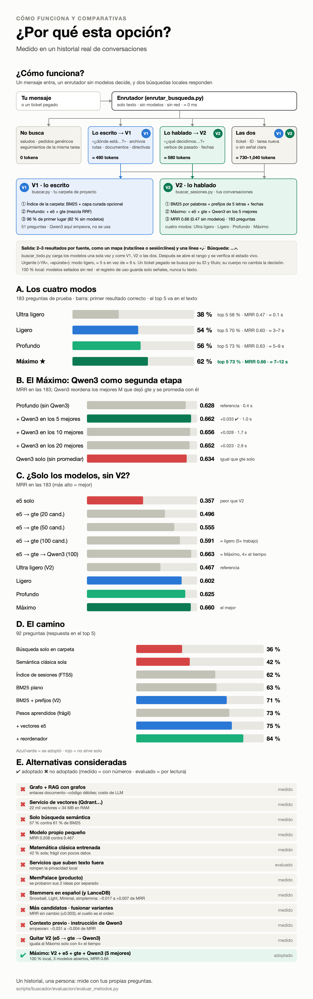

# brain-optimized-memory-for-claude-code

**🇲🇽 [ESPAÑOL](#español)** (primero, aquí abajo) · **🇬🇧 [ENGLISH](#english)** (below, same page)

---

# ESPAÑOL

## Memoria local para Claude Code

Búsqueda 100 % local en tus **conversaciones pasadas de Claude Code**, más un sistema de *directivas*, *memoria* y *skills* reutilizables que hace que Claude siga tus reglas con poco contexto. Nada sale de tu equipo mientras buscas; lo único que usa la red es instalar dos modelos abiertos, una sola vez.


## Qué incluye
- **`scripts/buscador/`**: búsqueda de conversaciones. **V2** (BM25 sobre palabras y prefijos de 5 letras + fusión RRF + fechas en español, SQLite FTS5, solo biblioteca estándar de Python) y dos modos con modelos: **ligero** (candidatos de V2 reordenados por `gte-multilingual-reranker-base`) y **profundo** (suma vectores de `multilingual-e5-small`). Ambos corren sin red, en un entorno aislado, con modelos de solo lectura y verificados por huella. **Al terminar la instalación el entorno queda sellado automáticamente: ni usando su Python directamente puede salir a internet** (compruébalo cuando quieras con `scripts/buscador/verificar_aislamiento.py`).
- **`scripts/directivas-buscador/`**: un hook que en cada mensaje inyecta solo las directivas y memorias más afines, para no cargar un archivo de reglas largo cada vez.
- **`.context/`, `plantillas/`**: directivas de ejemplo, palabras de disparo, `CLAUDE.md`, configuración de hooks y memorias (todo ficticio; reemplázalo por lo tuyo).
- **`skills/`**: tres skills reutilizables: `buscar-conversaciones`, `trazabilidad`, `actualizar-directivas`.
- **`docs/`**: manual de instalación, arquitectura, directivas y memoria, seguridad y privacidad, resultados y lecciones.

## Inicio rápido
> 💡 **Pídele a tu Claude que te ayude con la instalación.** Abre Claude Code en tu proyecto y pega este mensaje: «*Lee README.md y docs/instalacion.md de este repositorio y ayúdame a instalar la búsqueda local de conversaciones en mi proyecto. Antes de ejecutar nada, dime qué vas a hacer; pídeme confirmación antes del único paso con red (preparar_profundo.py). No modifiques mi CLAUDE.md ni mi .claude/settings.json sin mostrarme el cambio, y no subas nada a internet. Al terminar corre verificar_aislamiento.py y tests/smoke_test.py.*». El **manual completo paso a paso** (requisitos, instalación, verificación, problemas frecuentes y desinstalar) está en [`docs/instalacion.md`](docs/instalacion.md).

Requiere Python ≥ 3.12. **macOS: probado** (la capa de sistema contra la red usa `sandbox-exec`) · **Linux: no probado** · **Windows: no compatible tal cual** (solo modo `--solo-v2`, o WSL2 sin probar). Detalle en [`docs/instalacion.md`](docs/instalacion.md).
```bash
# 1) opcional, una vez (con red): instalar el entorno aislado y los dos modelos; al terminar se sella solo contra internet
python3 -I scripts/buscador/preparar_profundo.py

# 2) buscar en las sesiones del proyecto actual (por defecto, modo ligero)
python3 -I scripts/buscador/buscar_sesiones.py "¿qué decidimos del formato del reporte semanal?" --excluir <uuid de la sesión actual>
python3 -I scripts/buscador/buscar_sesiones.py "pregunta vaga o parafraseada" --profundo
python3 -I scripts/buscador/buscar_sesiones.py "término exacto" --solo-v2     # sin modelos
```
Para usar las directivas y el hook en tu proyecto: copia `scripts/`, `.context/` y `plantillas/CLAUDE.md` (como `CLAUDE.md`), mezcla `plantillas/settings.json` en `.claude/settings.json`, copia `skills/*` a `.claude/skills/` y escribe tus directivas con el formato descrito al inicio de `.context/directivas.md`. Luego corre `python3 -I scripts/directivas-buscador/directivas_buscador.py mapa`.

Variables de entorno: `BUSCADOR_HOME` (dónde viven índice y modelos, por defecto `~/.memoria-local`), `CLAUDE_PROJECT_DIR`, `BUSCADOR_ZONA` (zona horaria), `BUSCADOR_SIGLAS` (siglas de 2 letras que cuentan como palabra).

## Por qué esta opción (comparativas)



> **Una persona, un historial:** las cifras son orientación, no garantía. Mide con tus propias preguntas (`scripts/buscador/evaluacion/evaluar_metodos.py`). Todo el detalle está en [`docs/resultados.md`](docs/resultados.md). **MRR** = qué tan arriba queda la respuesta correcta (1 = siempre primera).

### 1. Los tres modos (183 preguntas de prueba, parte escritas por Claude)
| Modo | Respuesta en el top 5 | Primer resultado | MRR | Comando completo |
|:--|:--|:-:|:-:|:-:|
| **V2 solo** (sin modelos) | `████████████░░░░░░░░` 58 % | 38 % | 0.467 | ≈ 0.1 s |
| **Ligero** (V2 + reordenador) | `██████████████░░░░░░` 70 % | 54 % | ≈ 0.60 | ≈ 7 s |
| **Profundo** (V2 + vectores + reordenador) | `███████████████░░░░░` 73 % | 56 % | ≈ 0.63 | ≈ 9 s |

### 2. ¿Y si usamos solo los modelos, sin V2? (MRR en las mismas 183)
| Opción | MRR | Lectura |
|:--|:-:|:--|
| e5 solo (vectores) | 0.357 | ❌ peor que V2 solo |
| e5 → reordenador gte, 20 candidatos | 0.496 | queda cerca de V2 solo |
| e5 → reordenador gte, 50 candidatos | 0.555 | |
| e5 → reordenador gte, 100 candidatos | 0.591 | ≈ ligero (diferencia no significativa), con 5 veces más trabajo del reordenador |
| V2 solo | 0.467 | referencia |
| **Ligero** | **0.602** | ✅ |
| **Profundo** | **0.625** | ✅ el mejor; la respuesta está entre los 100 primeros candidatos en 163 de 183 con V2 y en 153 con vectores: **se complementan** |

### 3. Cómo llegamos aquí (92 preguntas; respuesta en el top 5 · primer resultado)
| Paso | Top 5 | 1.º | Qué aprendimos |
|:--|:--|:-:|:--|
| Búsqueda solo en la carpeta de trabajo (documentos + hook) | `███████░░░░░░░░░░░░░` 36 % | 18 % | no ve las conversaciones: 0 % en lo que solo vive en ellas |
| Semántica clásica sola (PPMI + SVD con el propio texto) | `████████░░░░░░░░░░░░` 42 % | 23 % | mala sola; mezclada con BM25 empeora (61 %) |
| Índice de sesiones con FTS5 | `████████████░░░░░░░░` 62 % | 41 % | el primer salto: los hechos que solo viven en conversaciones pasan de 19 % a 54 % |
| BM25 plano | `█████████████░░░░░░░` 63 % | 48 % | |
| **BM25 + prefijos de 5 letras (RRF) = V2** | `██████████████░░░░░░` 71 % | 50 % | la ganancia sin modelos viene de fusionar un índice de prefijos (variantes de palabra); más letras no sube la precisión |
| Pesos aprendidos con 14 señales | `███████████████░░░░░` 73 % | 52 % | frágil con pocos datos: el 77 % de una partición fue suerte |
| + vectores e5-small | `███████████████░░░░░` 75 % | 47 % | complemento: solo semántico (57 %) es peor que BM25 (61 %) |
| **+ reordenador gte (leer pregunta y turno juntos)** | `█████████████████░░░` 84 % | 70 % | el salto grande |

### 4. Otras opciones que consideramos
| Opción | Qué vimos | Decisión |
|:--|:--|:--|
| **Búsqueda solo en la carpeta / archivos de instrucciones** (CLAUDE.md, skills) | Complementan, pero no ven lo hablado: 19 % en hechos que solo viven en conversaciones (48 preguntas independientes) contra 54 % con un índice de sesiones | ✅ siguen como primera línea para lo documentado |
| **Grafo de conocimiento** (graphify) y **RAG con grafos** | Probado sin LLM sobre ≈ 2,500 nodos: útil como mapa visual por tema, pero solo 124 de ≈ 3,200 aristas eran enlaces reales entre documentos y los enlaces documento→código eran débiles; para documentos exige un LLM (costo y privacidad). Sin evidencia de que supere a BM25 + vectores | ❌ para recuperar conversaciones |
| **Base de datos de vectores como servicio** (Qdrant y similares) | Los vectores de ≈ 22 mil turnos ocupan ≈ 34 MB: caben en memoria con numpy | ❌ innecesaria |
| **Solo búsqueda semántica** (e5-small, bge-m3) | 57 % y 56 % en el top 5 contra 61 % de BM25 (77 preguntas); mezclada sube a 74–77 %; bge-m3 tardó 1,027 s contra 85 s, usó 4 veces más disco y no ganó | ✅ vectores solo como complemento (e5-small) |
| **Modelo propio pequeño** (destilación de dos reordenadores) | MRR 0.208 solo y 0.351 reordenando los 20 de V2 (V2: 0.467) | ❌ no supera a V2 (0.208 contra 0.467) |
| **Matemática clásica entrenada con el propio texto** | 42 % sola; los pesos aprendidos llegan a 73 % pero son frágiles | ❌ queda V2 con prefijos |
| **Afinar BM25** (27 variantes, 64 configuraciones) | Ninguna mejoró de forma significativa: el orden léxico está en su techo | ❌ sin mejora: el orden léxico ya está en su techo |
| **MemPalace** | Se probaron sus dos ideas por separado: guardado automático al compactar (sin mejora: el resumen conserva 77–85 %) e índice aparte de sesiones pasadas (funciona; es la base de esta herramienta) | ✅ la idea del índice · ❌ el producto (superficie amplia de herramientas) |
| **Servicios de memoria que envían el texto fuera** (p. ej. mem4dev, según su documentación) | Suben el texto de las conversaciones a servicios externos | ❌ incompatible con privacidad local |
| **Plugins que graban y resumen con un LLM** (claude-mem, según su README) | Podrían capturar salidas con credenciales y mandarlas a un LLM; gastan tokens extra | ❌ riesgo para la privacidad y gasto extra de tokens |
| **qmd** (BM25 + vectores + reordenador locales para notas Markdown) | El más parecido en espíritu, pero para notas en Markdown, no para las sesiones de Claude Code; modelos de ≈ 2 GB orientados al inglés | ⏸ no probado |
| **Engram** | No se evaluó | ⏸ pendiente |
Las evaluaciones de herramientas de terceros son de octubre y noviembre de 2026 (documentación, README y código leídos; solo graphify se ejecutó, sin LLM y sin llaves de API); pueden haber cambiado.

### 5. Por qué esta opción
1. **Resuelve el hueco real:** los hechos que solo viven en conversaciones pasadas. En 35 preguntas sin documentar: carpeta 0 %, FTS5 49 %, V2 63 %, con modelos 80 %.
2. **100 % local:** sin servicio, sin llaves de API y sin telemetría; dos modelos abiertos sellados al instalar y la red bloqueada en tres capas.
3. **Escalonada:** pagas tiempo solo cuando hace falta (0.1 s → 7 s → 9 s) y Claude decide el modo.
4. **Fácil de replicar:** V2 usa solo la biblioteca estándar de Python y SQLite; los modelos son opcionales.
5. **Honesta con sus límites:** las preguntas de «dos pasos» casi siempre fallan; puede devolver decisiones ya superadas (mira la fecha); es un solo historial.

## Privacidad
El índice guarda **todo lo que escribiste, sin enmascarar** (contraseñas incluidas si las pegaste). Mantén `~/.memoria-local` privado y no lo publiques. Los modelos son abiertos (MIT y Apache-2.0), con commit fijado, huella verificada y de solo lectura; las búsquedas corren con la red bloqueada en tres capas (archivos, código, sistema). Los límites se describen con honestidad en `docs/seguridad-y-privacidad.md`.

## Pruebas
`python3 -I tests/smoke_test.py` arma un proyecto y sesiones sintéticas en una carpeta temporal y comprueba el analizador de fechas, la búsqueda, el mapa de directivas y el hook. Nunca toca tu índice real.

## Licencia
MIT. Los modelos de terceros conservan sus licencias (MIT, Apache-2.0).

---

# ENGLISH

## Local memory for Claude Code

100 % local search over your **past Claude Code conversations**, plus a small system of reusable *directives*, *memory* and *skills* that keeps Claude following your rules with little context. Nothing leaves your machine while you search; the only step that uses the network is installing two open models once.


## What is inside
- **`scripts/buscador/`** – conversation search. **V2** (BM25 over words and 5-letter prefixes + RRF fusion + Spanish date filters, SQLite FTS5, Python standard library only) and two model-based modes: **light** (V2 candidates re-ranked by `gte-multilingual-reranker-base`) and **deep** (also adds `multilingual-e5-small` vectors). Both run offline in an isolated environment, with read-only, hash-verified models. **When the install finishes, the environment is sealed automatically: even running its Python directly cannot reach the internet** (verify any time with `scripts/buscador/verificar_aislamiento.py`).
- **`scripts/directivas-buscador/`** – a hook that, on every message, injects only the directives and memories most relevant to it, so a long rules file does not have to be loaded every time.
- **`.context/`, `plantillas/`** – example directives, trigger words, `CLAUDE.md`, hook settings and memory files (all fictional examples; replace them with yours).
- **`skills/`** – three reusable skills: `buscar-conversaciones`, `trazabilidad`, `actualizar-directivas`.
- **`docs/`** – installation manual (Spanish and English), architecture, directives and memory, security and privacy, results and lessons (Spanish).

## Quick start
> 💡 **Ask your Claude to help you install it.** Open Claude Code in your project and paste this message: "*Read README.md and docs/instalacion.md in this repository and help me install the local conversation search in my project. Before running anything, tell me what you are going to do; ask me for confirmation before the only step that uses the network (preparar_profundo.py). Do not modify my CLAUDE.md or my .claude/settings.json without showing me the change, and do not upload anything to the internet. When finished, run verificar_aislamiento.py and tests/smoke_test.py.*". The **full step-by-step manual** (requirements, install, verification, common problems and uninstall) is in [`docs/instalacion.md`](docs/instalacion.md) (Spanish first, English below).

Requires Python ≥ 3.12. **macOS: tested** (the system network layer uses `sandbox-exec`) · **Linux: untested** · **Windows: not supported as is** (`--solo-v2` mode only, or WSL2, untested). Details in [`docs/instalacion.md`](docs/instalacion.md).
```bash
# 1) optional, once (needs network): install the isolated environment and the two models; it seals itself from the internet when it finishes
python3 -I scripts/buscador/preparar_profundo.py

# 2) search the sessions of the current project (default: light mode)
python3 -I scripts/buscador/buscar_sesiones.py "what did we decide about the weekly report format?" --excluir <current-session-uuid>
python3 -I scripts/buscador/buscar_sesiones.py "vague paraphrased question" --profundo      # deep mode
python3 -I scripts/buscador/buscar_sesiones.py "exact term" --solo-v2                         # no models
```
To use the directives and hook in your own project: copy `scripts/`, `.context/` and `plantillas/CLAUDE.md` (as `CLAUDE.md`) into it, merge `plantillas/settings.json` into `.claude/settings.json`, copy `skills/*` to `.claude/skills/`, and write your own directives following the format described at the top of `.context/directivas.md`. Then run `python3 -I scripts/directivas-buscador/directivas_buscador.py mapa`.

Environment variables: `BUSCADOR_HOME` (index/models location, default `~/.memoria-local`), `CLAUDE_PROJECT_DIR`, `BUSCADOR_ZONA` (time zone), `BUSCADOR_SIGLAS` (two-letter acronyms that count as words).

## Why this option (comparisons)


> **One person, one history:** numbers are guidance, not a guarantee. Measure with your own questions (`scripts/buscador/evaluacion/evaluar_metodos.py`). Full detail in [`docs/resultados.md`](docs/resultados.md) (Spanish). **MRR** = how high the correct answer ranks (1 = always first).

### 1. The three modes (183 test questions, part written by Claude)
| Mode | Answer in top 5 | First result | MRR | Whole command |
|:--|:--|:-:|:-:|:-:|
| **V2 only** (no models) | `████████████░░░░░░░░` 58 % | 38 % | 0.467 | ≈ 0.1 s |
| **Light** (V2 + reranker) | `██████████████░░░░░░` 70 % | 54 % | ≈ 0.60 | ≈ 7 s |
| **Deep** (V2 + vectors + reranker) | `███████████████░░░░░` 73 % | 56 % | ≈ 0.63 | ≈ 9 s |

### 2. What if we use only the models, without V2? (MRR on the same 183)
| Option | MRR | Reading |
|:--|:-:|:--|
| e5 only (vectors) | 0.357 | ❌ worse than V2 alone |
| e5 → gte reranker, 20 candidates | 0.496 | close to V2 alone |
| e5 → gte reranker, 50 candidates | 0.555 | |
| e5 → gte reranker, 100 candidates | 0.591 | ≈ light (difference not significant), with 5× the reranking work |
| V2 only | 0.467 | reference |
| **Light** | **0.602** | ✅ |
| **Deep** | **0.625** | ✅ the best; the answer is among the top-100 candidates in 163 of 183 with V2 and 153 with vectors: **they complement each other** |

### 3. How we got here (92 questions; answer in top 5 · first result)
| Step | Top 5 | 1st | What we learned |
|:--|:--|:-:|:--|
| Search only the working folder (docs + hook) | `███████░░░░░░░░░░░░░` 36 % | 18 % | it cannot see conversations: 0 % on facts that live only in them |
| Classical semantics alone (PPMI + SVD on your own text) | `████████░░░░░░░░░░░░` 42 % | 23 % | poor alone; fused with BM25 it gets worse (61 %) |
| Session index with FTS5 | `████████████░░░░░░░░` 62 % | 41 % | the first jump: facts that live only in conversations go from 19 % to 54 % |
| Plain BM25 | `█████████████░░░░░░░` 63 % | 48 % | |
| **BM25 + 5-letter prefixes (RRF) = V2** | `██████████████░░░░░░` 71 % | 50 % | the no-model gain comes from fusing a prefix index (word variants); more letters does not help |
| Learned weights with 14 signals | `███████████████░░░░░` 73 % | 52 % | fragile with little data: the 77 % of one split was luck |
| + e5-small vectors | `███████████████░░░░░` 75 % | 47 % | a complement: semantic alone (57 %) is worse than BM25 (61 %) |
| **+ gte reranker (reads question and turn together)** | `█████████████████░░░` 84 % | 70 % | the big jump |

### 4. Other options we considered
| Option | What we saw | Decision |
|:--|:--|:--|
| **Searching only the folder / instruction files** (CLAUDE.md, skills) | They complement but cannot see what was said: 19 % on facts that live only in conversations (48 independent questions) vs 54 % with a session index | ✅ kept as first line for documented things |
| **Knowledge graph** (graphify) and **graph RAG** | Tried without an LLM on ≈ 2,500 nodes: useful as a visual topic map, but only 124 of ≈ 3,200 edges were real links between documents and document→code links were weak; for documents it needs an LLM (cost and privacy). No evidence it beats BM25 + vectors | ❌ for recalling conversations |
| **Vector database as a service** (Qdrant and similar) | Vectors for ≈ 22 k turns take ≈ 34 MB: they fit in memory with numpy | ❌ unnecessary |
| **Semantic search alone** (e5-small, bge-m3) | 57 % and 56 % in the top 5 vs 61 % for BM25 (77 questions); fused it reaches 74–77 %; bge-m3 took 1,027 s vs 85 s, used 4× the disk and did not win | ✅ vectors only as a complement (e5-small) |
| **Own small model** (distilled from two rerankers) | MRR 0.208 alone and 0.351 re-ranking V2's top 20 (V2: 0.467) | ❌ does not beat V2 (0.208 vs 0.467) |
| **Classical math trained on your own text** | 42 % alone; learned weights reach 73 % but are fragile | ❌ V2 with prefixes stays |
| **Tuning BM25** (27 variants, 64 configurations) | None improved significantly: lexical ranking is at its ceiling | ❌ no gain: lexical ranking is already at its ceiling |
| **MemPalace** | Its two ideas were tested separately: auto-save on compaction (no gain: the summary keeps 77–85 %) and a separate index of past sessions (works; it is the basis of this tool) | ✅ the index idea · ❌ the product (wide tool surface) |
| **Memory services that send text out** (e.g. mem4dev, per its documentation) | They upload conversation text to external services | ❌ incompatible with local privacy |
| **Plugins that record and summarize with an LLM** (claude-mem, per its README) | They could capture outputs with credentials and send them to an LLM; they spend extra tokens | ❌ privacy risk and extra token cost |
| **qmd** (local BM25 + vectors + reranker for Markdown notes) | The closest in spirit, but for Markdown notes, not Claude Code session logs; ≈ 2 GB English-oriented models | ⏸ not tested |
| **Engram** | Not evaluated | ⏸ pending |
Third-party tool evaluations are from October–November 2026 (documentation, README and code read; only graphify was run, without an LLM or API keys); they may have changed.

### 5. Why this option
1. **It solves the real gap:** facts that live only in past conversations. On 35 undocumented questions: folder 0 %, FTS5 49 %, V2 63 %, with models 80 %.
2. **100 % local:** no service, no API keys, no telemetry; two open models sealed at install time and the network blocked in three layers.
3. **Tiered:** you pay time only when needed (0.1 s → 7 s → 9 s) and Claude picks the mode.
4. **Easy to replicate:** V2 uses only the Python standard library and SQLite; the models are optional.
5. **Honest about its limits:** "two-step" questions almost always fail; it may return superseded decisions (check the date); it is a single history.

## Privacy
The index stores **everything you typed, unmasked** (passwords included if you pasted them). Keep `~/.memoria-local` private; never publish it. Models are open (MIT and Apache-2.0), pinned to a commit, hash-verified and read-only; searches run with network blocked in three layers (files, code, system). Limits are described honestly in `docs/seguridad-y-privacidad.md`.

## Tests
`python3 -I tests/smoke_test.py` builds a throw-away project and synthetic sessions in a temp folder and checks the date parser, search, directive map and hook. It never touches your real index.

## License
MIT. Third-party models keep their own licenses (MIT, Apache-2.0).
